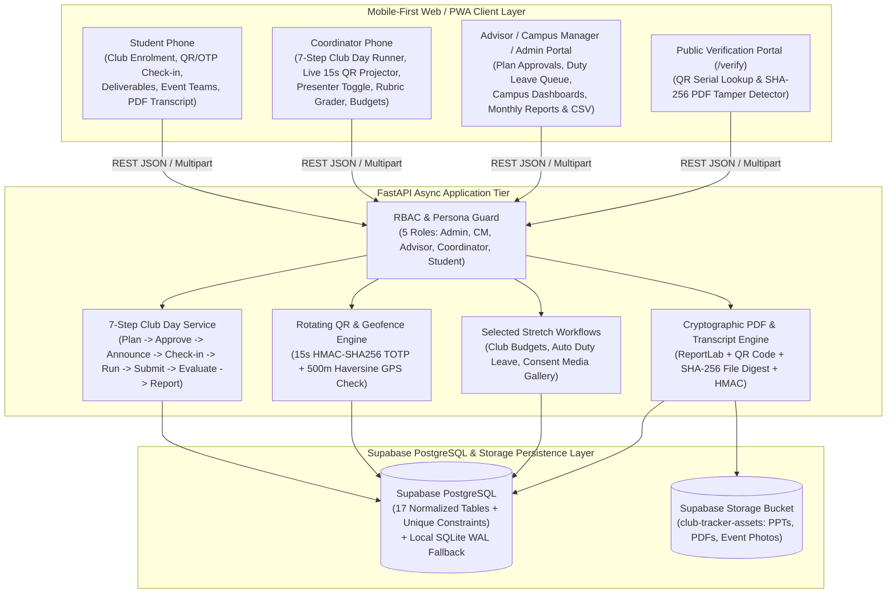

# MSOT Club Activities Tracker — Architecture & System Design Document

## 1. Executive Summary & Core Design Principles
The **MSOT Club Activities Tracker** is a unified, mobile-first platform built to manage the end-to-end co-curricular lifecycle across all four MSOT campuses (**HI-Tech**, **Ratnam**, **RGIB**, and **JUJ**). Every architectural decision is anchored in the three core principles of Problem 3:
1. **Verified Record:** Every participation entry is backed by a cryptographic QR/OTP check-in, a timestamped deliverable submission, or an audited Coordinator/Faculty Advisor approval.
2. **Low Effort for Coordinators:** Student coordinators can run a Saturday Club Day from their phone in a few taps—projecting a live rotating QR code, marking presenters, and scoring rubric evaluations.
3. **Student-Owned Co-Curricular Transcript:** Every student can generate and download an official, tamper-evident PDF Co-Curricular Transcript and individual PDF certificates embedded with public QR verification links and SHA-256 digests.

---

## 2. System Architecture Diagram

---

## 3. Data Model & Supabase Integration
The persistence layer is designed for **Supabase PostgreSQL** ([`supabase/schema.sql`](../supabase/schema.sql)) and **Supabase Storage** (`club-tracker-assets` bucket), with an automatic zero-configuration **SQLite WAL fallback** so evaluators can run tests or demos offline with a single command.

### Key Relational Integrity & Concurrency Guarantees
* **Configurable Enrolment Limits (`club_memberships`):** Unique constraint on `(club_id, student_id)` plus application-level enforcement of `max_primary_clubs = 1` and `max_secondary_clubs = 1`.
* **Idempotent Saturday Check-Ins (`attendances`):** Composite unique constraint `uq_session_student_attendance (session_id, student_id)` ensures that 500 concurrent Saturday morning check-ins never produce duplicate rows.
* **Duplicate-Free Event & Team Registrations (`event_teams`, `event_registrations`):** Composite unique constraints on `(event_id, team_name)` and `(event_id, student_id)` guarantee zero duplicate registrations or lost entries during 200+ concurrent student signups.

---

## 4. Security, Verification & Anti-Cheat Design

### A. Anti-Screenshot Rotating QR Check-In & Campus Geofencing
1. **15-Second Time-Bucketed HMAC Token:** Each Club Day session has a 128-bit `checkin_secret`. Every 15 seconds, the server derives a deterministic token `MSOT-QR:{session_id}:{time_bucket}:{hmac_sha256[:16]}` and a 6-digit OTP.
2. **Anti-Screenshot Rejection:** Only the current 15-second bucket and `bucket - 1` (grace window for network jitter) are accepted. If a student shares a screenshot on WhatsApp and another student scans it 45–60 seconds later, the server detects the valid HMAC on an expired bucket and rejects it with `403 EXPIRED_QR_SCREENSHOT`, logging the attempt in `audit_logs`.
3. **Campus Haversine Geofence:** The check-in endpoint computes the Haversine distance between the student's GPS coordinates and the campus coordinates (`HI-Tech`, `Ratnam`, `RGIB`, `JUJ`). Check-ins outside the `500m` radius are rejected with `403 OUTSIDE_CAMPUS_GEOFENCE`.
4. **Late Window & Audited Coordinator Overrides:** Check-ins occurring after `checkin_late_after` (15 minutes after session start) are automatically flagged `LATE`. Manual coordinator corrections require a mandatory `override_reason` ($\ge 5$ chars) and record `overridden_by_id`.

### B. Tamper-Proof PDF Certificates & Co-Curricular Transcripts
1. **Dual Cryptographic Sealing:** When a certificate or student transcript PDF is generated (`invariant=1`), the engine embeds a scannable QR code (`/verify/{serial_number}`), computes an `HMAC-SHA256` over the core record fields, and records the exact `SHA-256` hash of the generated PDF binary in the `certificates` table.
2. **Tamper Detection (`/api/verify/pdf`):** Uploading any PDF recomputes its `SHA-256` byte digest. If even a single byte, character, or score in the PDF was modified in a PDF editor, the digest mismatches the ledger and immediately returns `TAMPERED_PDF_DETECTED`.

---

## 5. Selected Stretch Goals Architecture (Middle Three)
1. **Club Budget & Expense Approval Workflow (`budget_requests`):** Two-tier state machine (`PENDING_ADVISOR` $\rightarrow$ `PENDING_CAMPUS_MGR` $\rightarrow$ `APPROVED` / `REJECTED`) with audit notes at each stage.
2. **Automatic Duty Leave Generation (`duty_leave_requests`):** Registering for any event marked `duty_leave_eligible = true` (e.g., Inter-College International Conference or Gambade) automatically creates a `PENDING_CM_APPROVAL` Duty Leave record routed to the student's Campus Manager.
3. **Event Photo / Media Gallery with Consent Controls (`media_gallery_items`):** Photos tagged with a student include a `student_consent` boolean flag. Students can revoke consent in 1 click, immediately filtering the photo out of public gallery queries (`WHERE student_consent = true`).
